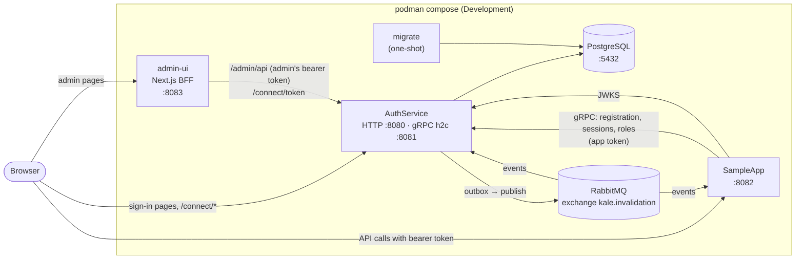
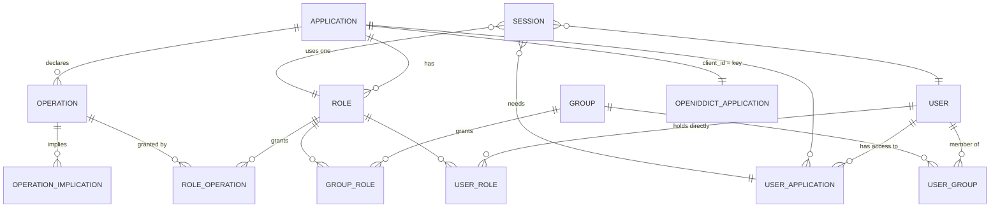
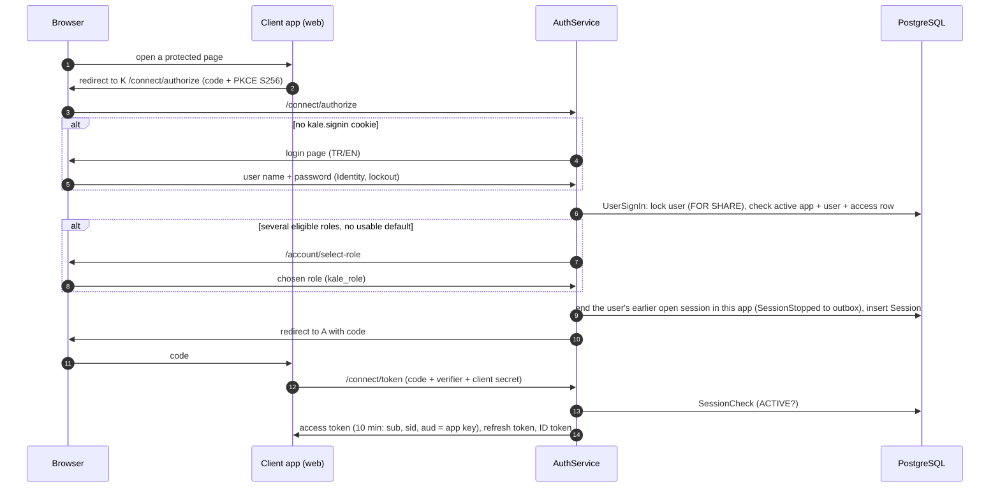
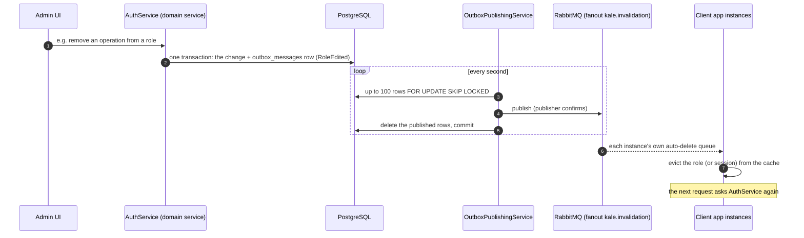

# Kale: handover

*Written by Claude (Anthropic's AI coding assistant), which wrote most of Kale's code under the project owner's direction between 2026-10-04 and 2026-11-04. As of 2026-11-05. Türkçe: [handover.tr.md](handover.tr.md).*

This is for the developers who take Kale over. It doesn't repeat what other files already say well. It tells you where to look, what's missing, and why things are the way they are.

**Language.** Sections 0–5 and 13 are in both languages. Sections 6–12 are technical and change with the code, so they are in English only. Two copies would soon disagree.

## Contents

0. [How to read this](#0-how-to-read-this)
1. [Kale on one page](#1-kale-on-one-page)
2. [Your first day](#2-your-first-day)
3. [Access, secrets, feeds, contacts](#3-access-secrets-feeds-contacts)
4. [Open work, risks and gaps](#4-open-work-risks-and-gaps)
5. [Suggested next steps](#5-suggested-next-steps)
6. [Architecture and domain](#6-architecture-and-domain)
7. [How data flows](#7-how-data-flows)
8. [Decision log: the alternatives and why](#8-decision-log-the-alternatives-and-why)
9. [Security, and a server-side production checklist](#9-security-and-a-server-side-production-checklist)
10. [Code tour: where do I change X?](#10-code-tour-where-do-i-change-x)
11. [Testing and how we work](#11-testing-and-how-we-work)
12. [Troubleshooting (server and dev stack)](#12-troubleshooting-server-and-dev-stack)
13. [Glossary](#13-glossary)

---

## 0. How to read this

**Reading order.** On your first day, read sections 1–4. Read the rest when you start on that part of the code.

**Where each kind of fact lives.** If two sources disagree, trust them in this order: the code, then `CLAUDE.md`, then this document, then `DESIGN.md`.

| File | What it is | How far to trust it |
|---|---|---|
| [CLAUDE.md](../../CLAUDE.md) | The rules and every **approved decision**, kept up to date with each PR. Claude Code also reads it as its instructions (see [section 11](#11-testing-and-how-we-work)). | The most current description in prose. |
| [docs/DESIGN.md](../DESIGN.md) | The **original brief** that the owner gave Claude on day one: requirements, phases, open items. | Historical. It describes what was asked for, not what was built. All of its "Open items" have been decided since (`CLAUDE.md`, "Decisions on the spec's open items"). Its phase list ends at 6; the admin UI came later as Phase 7. |
| [docs/design/phase-3-openiddict.md](../design/phase-3-openiddict.md) | The approved proposal for how OpenIddict's tables relate to our `applications`, and how keys are handled (option A). | Current. |
| [docs/design/locking.md](../design/locking.md) | Which code locks which rows, in which order, and why. | Current (new with this handover). |
| [docs/integration/](../integration/README.md) | For **teams whose applications use Kale**: quick start and full guide, TR and EN. Its samples were run against the stack. | Current. Keep it in step with any change an application would notice. |
| Code comments | The *why* behind lines that aren't obvious (a convention in this repo). | Current. Read them: they hold most of the reasoning. |

## 1. Kale on one page

**The problem.** The owner had several C# APIs, each with its own copy-pasted authentication code, so a bug fix had to be made in every copy.

**What Kale is.**
- **AuthService**: one central service that owns users, groups, applications, roles, operations and sessions. It's an OpenID Connect server (OpenIddict) with its own sign-in pages.
- **Kale.Auth.Client**: a thin NuGet package. An application adds it and protects endpoints with `[Authorize(MyOperations.X)]`. It holds no data: on each request it asks AuthService over gRPC (with caching) whether the session is active and which operations the session's role has.
- **Admin UI**: a Next.js app in Turkish and English where administrators manage everything.

**Who uses it.**

| Who | What they do |
|---|---|
| Application teams | Register their app, declare operations as a C# enum, and add the package (see `docs/integration`). |
| Administrators | Create users, groups and roles, and grant access, in the admin UI. |
| End users | Sign in on Kale's pages and pick a role when they have more than one. |

**State on 2026-11-05.**

| Phase (`DESIGN.md`) | State |
|---|---|
| 0 Environment, `CLAUDE.md` | Done |
| 1 Data model and migrations | Done |
| 2 Application registration and operation sync | Done |
| 3 OpenIddict, sign-in, role selection, sessions, tokens | Done |
| 4 Client package | Done; version **1.0.0** (`Directory.Build.props`) |
| 5 Invalidation events (RabbitMQ, outbox) | Done |
| 6 SampleApp end to end, everything in `podman compose` | Done; `scripts/smoke-test.sh` checks it |
| 7 Admin UI | Done; `scripts/browser-test.sh` checks it in a real browser |

Since then the work has been polish and fixes: restyling the sign-in pages, RabbitMQ's first start, and Windows support (paused, see section 4).

All of this happened in one month: 67 merged PRs, each one feature branch. Each PR was reviewed by the `pr-reviewer` agent and approved by the owner.

**Not yet:** Kale has **never been deployed to production or to a production-like environment**. Everything has been run locally, on macOS (Apple Silicon) and Windows 10, with Podman. Section 9 lists what a first deployment has to settle.

## 2. Your first day

**Install:**
- the .NET SDK version in `global.json`
- Podman, with podman-compose 1.6
- Node 22
- git and jq

On Windows you also need Git Bash, because the scripts are bash. Kale was built on **macOS (Apple Silicon)** and every image is multi-arch.

**Windows.** It works, but with manual steps:
- Run the bash scripts from Git Bash.
- Behind the company's TLS-inspecting proxy, the Podman VM and the image builds must trust the proxy's certificate.

PR #68 (`scripts/dev-stack.ps1`) automates all of this but is paused (section 4). Its description lists every Windows problem found and how to get past it.

**Steps:**

1. Start Podman: `podman machine start`. Do this once after each reboot.
2. Tell Testcontainers where Podman is: create `~/.testcontainers.properties` with `ryuk.disabled=true` and a `docker.host` line.
   - **macOS:** `docker.host=unix://<socket>`. Get the socket with `podman machine inspect --format '{{.ConnectionInfo.PodmanSocket.Path}}'`.
   - **Windows:** `docker.host=npipe://./pipe/docker_engine`. Podman serves this pipe while its machine runs.
3. Start the stack: `./scripts/dev-stack.sh`. It creates `.env` and the secrets, builds the images, and starts PostgreSQL, RabbitMQ, the migration, AuthService, SampleApp and the admin UI. It prints the addresses:
   - AuthService: `http://auth.kale.localhost:8080/`
   - SampleApp: `http://localhost:8082/notes`
   - Admin UI: `http://localhost:8083/` (user `admin`). Get the password with `podman secret inspect --showsecret --format '{{.SecretData}}' kale_admin_password`.
4. Check that it works: `./scripts/smoke-test.sh` (a real sign-in, allow and deny by role, and a role edit arriving over RabbitMQ). Then `dotnet build && dotnet test`, and `(cd admin-ui && npm ci && npm test && npm run typecheck && npm run build)`.
5. Try it by hand:
   - In the admin UI, create a user, give them access to `sample` with a role, and sign in to SampleApp as that user.
   - Then take the role away and watch the next request get refused.
   - The admin UI's **Test token** page gives you a token without a web front end.
6. Read [docs/integration/quickstart.en.md](../integration/quickstart.en.md). It's how other teams see Kale.

**Stop the stack:** `podman compose down`. Adding `-v` also deletes the database and the broker data. The next `dev-stack.sh` then recreates the database, the `sample` application and the first admin, with new client secrets for `sample` and the admin UI. The PostgreSQL, RabbitMQ and admin passwords are Podman secrets, not volumes, so they stay.

## 3. Access, secrets, feeds, contacts

*Placeholders: the owner fills these in before handing over.*

| What | Where / who |
|---|---|
| Repository | `github.com/TasTugberk/Kale`. **A personal account.** Move it to an organisation account, or add the new maintainers as admins: `<to fill>` |
| Project owner (decisions, approvals) | `<name, contact>` |
| Other people who know the system | `<names>` |
| NuGet feed for `Kale.Auth.Client` and `Kale.Auth.Contracts` | `<feed URL>`. Nothing is configured yet: `scripts/publish-client.sh <feed>` pushes to any feed you give it, with the API key on stdin. Version 1.0.0 is built but `<published? where?>` |
| Applications already using the package | `<list, or "none yet">` |
| Production / test environments | `<none yet>` |
| Production secrets: database password, RabbitMQ password, admin UI client secret, Data Protection certificate and key | `<secret store, who has access>`. They must reach the services as files (section 9) |
| Production database backups | `<where, how often, who checks restores>`. See section 9 for what must be backed up together |
| Development secrets | Podman secrets on each developer's machine, created by `dev-stack.sh`: `kale_postgres_password`, `kale_rabbitmq_password`, `kale_sample_client_secret`, `kale_admin_password`, `kale_admin_ui_client_secret`. Nothing to hand over: every machine makes its own |
| Machine-specific setup not in the repo | `~/.testcontainers.properties` (section 2). User secrets for running AuthService with `dotnet run` (`scripts/dev-db.sh` writes them) and for applications (`scripts/register-app.sh`) |
| Claude Code setup | In the repo: `CLAUDE.md` and `.claude/agents/pr-reviewer.md`. Each user's Claude Code memory (notes it keeps between sessions) is on that user's machine, not in the repo. Anything in it that matters is in this document |

## 4. Open work, risks and gaps

Each row has a GitHub issue. Keep the backlog in the issues: add new work there, not here, and update this table only when an item closes or a new risk deserves a line.

| Item | Why it matters | Issue |
|---|---|---|
| **No CI** | Build, tests and image builds run only on developers' machines and through the `pr-reviewer` agent. Nothing stops a PR whose tests weren't run. | [#70](https://github.com/TasTugberk/Kale/issues/70) |
| **Never run in production** | TLS on Kestrel, `amqps`, the Data Protection certificate and backups have been written and unit-tested, but never deployed together (section 9). | [#72](https://github.com/TasTugberk/Kale/issues/72) |
| **Behind a TLS-terminating proxy** | AuthService doesn't process forwarded headers, so behind such a proxy OpenIddict would see plain `http` and refuse. Today, run TLS on Kestrel itself, or fix this first. | [#72](https://github.com/TasTugberk/Kale/issues/72) |
| **Passwords can't be changed or reset; no MFA** | A password is set only when a user is created. Someone who forgets theirs needs a new account. `DESIGN.md` chose Identity partly for MFA, but MFA isn't built. | [#71](https://github.com/TasTugberk/Kale/issues/71) |
| **Locking: a shared advisory lock and a possible deadlock** | `KeyRing` and `LastAdminCheck` both use advisory lock `(1002, 0)`, so key rotation and last-admin checks wait for each other (harmless, a two-line fix). Separately, two admins changing the same `auth` admin role at the same moment might deadlock; PostgreSQL would fail one request. Not reproduced ([locking.md](../design/locking.md)). | [#73](https://github.com/TasTugberk/Kale/issues/73) |
| **Registering operations doesn't invalidate client caches** | When an app redeploys with fewer operations or changed `[Implies]`, its instances keep the old effective operations for up to 5 minutes. | [#74](https://github.com/TasTugberk/Kale/issues/74) |
| **Admin UI sessions live in memory** | One instance only. A restart signs every admin out. | [#75](https://github.com/TasTugberk/Kale/issues/75) |
| **No secret-provider abstraction** | `DESIGN.md` asked for one. Secrets are files only. Decide whether files are enough. | [#76](https://github.com/TasTugberk/Kale/issues/76) |
| **Observability** | Only `GET /health`, which doesn't check the database. No metrics or traces. | [#77](https://github.com/TasTugberk/Kale/issues/77) |
| **Audit** | Only domain events (hooks), as decided. No stored record of who changed what. | [#78](https://github.com/TasTugberk/Kale/issues/78) |
| **PR #68: Windows dev stack, paused** | `scripts/dev-stack.ps1`. The pushed version works end to end. The fixes from the review sit **uncommitted** in another worktree on the owner's machine, and the company antivirus blocks the rewritten script as "malicious content". Decide: (a) ask IT to allow it as a false positive; (b) read the first admin's password inside a container from its Podman secret, so no secret passes through PowerShell; or (c) close it and document the Git Bash route. | [#68](https://github.com/TasTugberk/Kale/pull/68) |

**Limits by design** (decided, not bugs; change them only on purpose):
- One open session per user and application. Signing in again elsewhere ends the earlier session.
- One superadmin level (`auth.Admin`). Application owners can't manage only their own roles.
- Groups are flat (no nesting).
- Renaming an enum member creates a new operation, and the old one becomes obsolete.
- Each instance of a client application has its own cache. If a shared cache is ever needed, use Valkey, not Redis.

## 5. Suggested next steps

In this order:

1. **Ownership.** Fill in section 3, and move the repository to an organisation account (it carries the issues and PRs with it).
2. **CI.** Without it, every other change is a risk.
3. **A first deployment to a test environment**, following section 9. Settle the reverse-proxy question there.
4. **Password reset by an administrator**, then changing your own password. Plan MFA as a separate design.
5. **Small fixes:** the shared advisory lock, and the cache invalidation after operation registration.
6. **Observability:** OpenTelemetry metrics and traces, and a database check in `/health`.
7. **Publish `Kale.Auth.Client` 1.0.0** to the company feed, and connect the first real application by following the integration guide. Its feedback is worth more than any other next feature.
8. **Decide on PR #68.**

---

## 6. Architecture and domain

### 6.1 Components

| Component | Owns | Doesn't |
|---|---|---|
| `src/AuthService` | The database (EF Core, migrations); OpenIddict (OIDC/OAuth endpoints, keys); sign-in pages (TR/EN); gRPC API for applications; admin REST API; outbox publisher; background jobs; admin CLI (`AuthService admin …`) | Call client apps |
| `src/Auth.Contracts` | `.proto` files: registration, sessions, roles, invalidation events. Published as `Kale.Auth.Contracts`. | Logic |
| `src/Auth.Client` | `AddKaleAuth<TOperations>()`, `[Authorize(...)]`, `[Implies(...)]`, policy provider, JWT validation, the app's own client-credentials token, gRPC lookups with caches, operation registration at startup, `InvalidationListener`. Published as `Kale.Auth.Client`. | Store anything beyond short caches |
| `admin-ui` | Next.js backend-for-frontend. Admins' tokens stay on its server. Pages for every admin task. | Touch the database: everything goes through `/admin/api` |
| `samples/SampleApp` | A minimal API using `Auth.Client` (`/notes`). End-to-end tests and the smoke test use it. | Anything else |

AuthService is also a client of itself. It is the application `auth`, with the operation `auth.Admin`, and it uses Auth.Client's `[Authorize]` (with lookups served in-process) and `InvalidationListener` to protect the admin API.

### 6.2 Runtime (the local compose stack)



- The **issuer** is `http://auth.kale.localhost:8080/` everywhere. Browsers and curl resolve `*.localhost` to this machine, and inside compose it's AuthService's network alias, with the same port. So the browser and SampleApp see the same token issuer and discovery URLs.
- Ports come from `.env`, and the defaults are shown above. They are published on `127.0.0.1` only. RabbitMQ isn't published to the host.
- The `migrate` container runs `AuthService admin migrate` before AuthService starts. It needs only the database connection.

### 6.3 Trust boundaries

| Boundary | What crosses it | What protects it |
|---|---|---|
| Browser ↔ AuthService | Password, the `kale.signin` cookie (8 h, httpOnly, never seen by apps), authorization codes | HTTPS in production, Identity lockout (5 tries, 15 min), PKCE S256, registered redirect URIs |
| Browser ↔ admin UI | Only the `kale_admin_session` cookie (httpOnly). Tokens never reach the browser. | Same-origin checks on every change (`requireSameOrigin`), sign-out as POST |
| Admin UI ↔ AuthService | The admin's access token (bearer), the UI's client secret | `auth.Admin` checked on every call. The sign-in cookie never counts on the admin API (against CSRF). |
| Client app ↔ AuthService | The app's client-credentials token (`aud` = `urn:kale:auth-api`), gRPC | `AppCaller` policy: active application on every call; other applications' data is `NOT_FOUND` |
| Client app ↔ its users | User access tokens (`aud` = app key, `sid`, `sub`) | Local JWT validation (JWKS), then a session check and an operations check on every request, denying access if AuthService doesn't answer |

### 6.4 Domain model



Also: `server_keys` (signing and encryption keys), `data_protection_keys` (the key ring that encrypts them), `outbox_messages`, and OpenIddict's `openiddict_*` tables. The entities are in `src/AuthService/Domain`, and their mapping is in `Persistence/Configurations`.

- **Global vs per application.** Users and groups are global. Operations, roles, access rows (`user_applications`) and sessions belong to one application.
- **The database enforces this, not just the code.**
  - Composite foreign keys carry `application_id`, so a role can't be granted another application's operation, and a session can't use another application's role. Their names end in `_same_application`.
  - The `{appKey}.` prefix on an operation's name is checked by the database, so an application's key can't change once it has operations.
  - Constraints have explicit names (`ck_…`, `fk_…`) so an error says which rule fired.
  - Sessions **restrict** deleting their user, role or access row, because a cascade would remove sessions without sending a "session stopped" event.
- **Operations** come only from the application's enum, sent at startup. Administrators never create them. An operation the app stops declaring becomes **obsolete**, never deleted. It can no longer be granted, and it's left out of effective operations.
- **Implications.** `[Implies(OrderRead)] OrderCreate` means that holding `OrderCreate` also gives `OrderRead`. They're stored in `operation_implications` (replaced on each registration). Registration refuses loops (`OperationImplications.FindCycle`). The full chain is followed when a role's **effective operations** are computed (`EffectiveOperations`, `OperationImplications.Expand`), so endpoints declare only the lowest operation they need.
- **An ACTIVE session**, the one definition used everywhere (`Sessions/SessionCheck.cs`): `IsActiveAt(now)` (not ended, not past its absolute lifetime) **and** the user, the access row and the application are active **and** the user still holds the session's role, directly or through a group. `EndedAt` is the only record of "ended": there is no status column.

## 7. How data flows

The details and edge cases are in `CLAUDE.md` ("Decisions"). This section shows how the pieces connect.

### 7.1 Registering an application and its operations

1. An administrator creates the application in the admin UI, or with `scripts/register-app.sh` / `AuthService admin create-application`. `ApplicationService` creates our `applications` row and the OpenIddict client in **one transaction**. The client secret is shown once, and only its hash is stored.
2. The application starts. `Auth.Client` gets a client-credentials token, reads its operations enum (names and `[Implies]`), and calls the gRPC `RegisterOperations` in the background.
   - It retries with growing waits (up to 30 s), except on `INVALID_ARGUMENT` (a bad name or a loop), which it logs.
   - Several instances may register at once. A per-application advisory lock makes them take turns.
3. An administrator creates roles, grants operations, and gives users access and roles.

### 7.2 Sign-in



- Choosing a role: the one asked for (`kale_role`) if eligible, otherwise the access row's default role if eligible, otherwise the only eligible role, otherwise the picker. With `prompt=none`, Kale answers `login_required` or `account_selection_required` instead of showing a page.
- The token holds no operations. They're looked up on each request (7.3).
- Code: `SignIn/AuthorizeEndpoint.cs`, `SignIn/UserSignIn.cs`, `Pages/Account/*`, `Tokens/TokenEndpoint.cs`, `Tokens/TokenClaims.cs`.

### 7.3 Each request in a client app

1. The JWT bearer handler validates the signature (from AuthService's JWKS), expiry, issuer, audience (= the app's key) and type (`at+jwt` only).
2. The policy from `[Authorize(...)]` (named `kale-operations:{enum}:{members}`) asks:
   - Is session `sid` active? Cached for **20 s**.
   - What are the effective operations of its role? Cached per role for **5 min**.
   Both questions go over gRPC to AuthService (`SessionGrpcService`, `RoleGrpcService`).
3. Several operations in one attribute mean OR. Several attributes mean AND.
4. **AuthService must answer.** If it doesn't answer within 5 s and nothing is cached, the request is refused (403). Access is never granted without AuthService's answer.

Code: `Auth.Client/OperationAuthorization.cs`, `SessionAccess.cs`, `GrpcLookups.cs`, `TimedCache.cs`.

### 7.4 Token refresh

The front end refreshes about a minute before the access token expires. On refresh, AuthService runs `SessionCheck` (the full ACTIVE definition above), so a stopped session or a lost role can't refresh, even before any event arrives. Refresh tokens are single-use, and each answer carries a new one. A session ends at most 8 h after sign-in, however often it's refreshed.

### 7.5 How a change reaches the client caches



- **Events:**
  - `SessionStopped` evicts the session from the cache.
  - `RoleEdited` evicts the role.
  - `UserDisabled` is for audit only; the sessions it stopped have their own `SessionStopped` events.

  The format is protobuf `InvalidationEvent` (`Auth.Contracts/Protos/invalidation.proto`).
- **Delivery is at least once.** Events are only hints to evict, so receiving one twice does no harm. Events sent while an instance is disconnected are lost, so `InvalidationListener` clears both caches whenever it (re)connects. The cache lifetimes (20 s and 5 min) are the fallback.
- **Only these services write events:** `SessionStopper` (the only way to end a session), `RoleEditor` (the only way to change a role) and `UserAccounts`. `UserAccess` and `GroupEditor` take roles away by stopping the sessions that no longer have their role. A new kind of change that client caches must see needs its own outbox row **in the same `SaveChanges`**.
- **More than one AuthService instance.** Rows are locked with `SKIP LOCKED`, so no two instances publish the same row. There's no "published" flag: a published row is deleted in the same transaction.

### 7.6 Admin UI (backend for frontend)

1. The admin signs in to the application `auth` with code + PKCE (`openid-client`). The admin UI keeps the tokens on its own server, in memory (`SessionStore`, 8 h), keyed by the httpOnly cookie `kale_admin_session`.
2. A page reads data in a server component (`adminApi`). A change goes through a server action that starts with `requireSameOrigin()`.
3. Both call `/admin/api` with the admin's bearer token. The token is renewed a minute before it expires, only once even when several calls run in parallel, because refresh tokens are single-use.
4. A 401, a 403 or a refused refresh drops the session and shows `/signed-out?state=session-ended`.

The decisions are in `admin-ui/src/lib/auth-flow.ts` (no Next.js, unit-tested); the routes only wire them up.

### 7.7 Background jobs (inside AuthService)

| Job | When | What |
|---|---|---|
| `ServerKeyRefresher` | Before startup completes, then hourly | Applies `KeyRotationPolicy` through `KeyRing` (a new key every 30 days, published 1 day before use, kept 1 day after its successor takes over), then reloads OpenIddict's keys without a restart. Broken key storage stops startup; later failures are logged and retried. |
| `SessionCleanupService` | Hourly | Deletes sessions that finished more than `Sessions:KeepFinishedFor` ago (default 7 days), and OpenIddict tokens and authorizations older than the same cutoff. |
| `OutboxPublishingService` | Every second, when `RabbitMq:Uri` is set | 7.5 above. |
| `InvalidationListener` (Auth.Client, also in AuthService) | Always | Consumes events; reconnects every 5 s when they stop arriving. |
| Operation registration (Auth.Client) | At app startup | 7.1 above. |

### 7.8 Configuration and secrets

**Rule:** a secret travels as a **file**, a mounted Podman secret, and never as an environment variable or in `.env`/compose. Everything else comes from configuration (`appsettings*.json`, environment, or `.env` through compose).

```
Podman secret ──mounted at /run/secrets/…──▶ *PasswordFile / *SecretFile setting ──▶ read at startup
```

| Service | Secret settings |
|---|---|
| AuthService | `AuthDb:PasswordFile` (added to `ConnectionStrings:AuthDb`), `RabbitMq:PasswordFile`, `DataProtection:CertificatePath` + `DataProtection:PrivateKeyPath` (PEM) |
| Client apps (Auth.Client) | `Kale:ClientSecretFile`, `Kale:RabbitMqPasswordFile` |
| Admin UI | `KALE_ADMIN_CLIENT_SECRET_FILE` |

For local `dotnet run`, user secrets take their place: `scripts/dev-db.sh` for AuthService, `scripts/register-app.sh` for an application.

## 8. Decision log: the alternatives and why

`CLAUDE.md` says **what** was decided. This table adds what else was considered and **why**. The decision rows in `CLAUDE.md` have the details.

Most reasons were written down when the decision was made (in `DESIGN.md`, `CLAUDE.md`, a design document or a code comment). The ones marked † weren't: they are my reconstruction. Treat them as likely, not as recorded.

| Decision | Alternatives considered | Why |
|---|---|---|
| **OpenIddict + ASP.NET Core Identity** | Duende IdentityServer, Keycloak | The owner's requirement. Duende isn't open source for commercial use. Keycloak is a separate Java product that would hold the data outside our model. OpenIddict (Apache 2.0) is a library, so its data lives in our database and transactions. † |
| **Our `applications` table owns applications; OpenIddict's client is linked 1:1 by key** | Keep two independent registrations | One home for each fact, changed only by `ApplicationService` in one transaction ([phase-3 doc](../design/phase-3-openiddict.md)). |
| **Keys in PostgreSQL, encrypted with Data Protection, rotated by AuthService (option A)** | PEM files/Podman secrets rotated by hand; ephemeral keys | `DESIGN.md` says keys are "generated and rotated inside the auth service". Works with several instances without shared files. |
| **No operations in tokens; looked up per request with caches** | Operations as token claims | A role change must take effect at once, even on tokens already issued. Tokens stay small. |
| **Code + PKCE, S256 only; access tokens 10 min, sessions 8 h** | Implicit flow; `plain` PKCE; longer tokens | Current OAuth best practice. Short tokens bound what a stolen one can do, and refresh re-checks the session. † |
| **One open session per user and application** | Several parallel sessions | Switching roles is a new sign-in. Keeping only one session makes "which role is this user acting as" clear and makes stopping simple. † |
| **Database constraints for cross-application integrity (composite FKs)** | Checks in code only | An owner rule: a bug or a hand-written SQL statement can't mix applications. |
| **UUID v7 ids, `timestamptz`, snake_case** | Sequential ints; `timestamp` | Ids are ordered by time (good for indexes), can't be guessed, and are safe to expose. Times have no time zone ambiguity. † |
| **RabbitMQ, fanout exchange, one auto-delete queue per instance** | NATS, Kafka | Small, low-volume events, at least once, with publisher confirms. Kafka is far too heavy for this. RabbitMQ is the more familiar choice to operate. † |
| **Raw `RabbitMQ.Client`, no MassTransit** | MassTransit | MassTransit v9+ isn't open source. The need is small (publish one event type, consume it). |
| **Outbox: rows deleted when published, no "published" flag** | A flag plus a cleanup job | Nothing to clean up. `SKIP LOCKED` lets several instances share the work. |
| **In-memory caches in each client instance** | Valkey (shared) | Enough for the first version. Events keep them fresh. Valkey (BSD) is the named option if a shared cache becomes necessary; Redis isn't, because of its license changes. |
| **One superadmin level (`auth.Admin`); AuthService registers itself as application `auth`** | Delegated admins per application | Simplest model that works. The admin API reuses Auth.Client's own `[Authorize]`, so it gets the same checks as every app. |
| **Last-admin check with an advisory lock** | Nothing (risk of locking everyone out) | Two admins removing each other at once would otherwise both succeed. |
| **Flat groups** | Nested groups | Simpler eligibility rules and locking. No need yet. † |
| **No enum rename support** | `[PreviousName]` attribute | Rare, and a rename can be done in steps (add, grant, remove). † |
| **Audit: domain events only, no table** | An audit table now | Not required yet. The outbox events are the hook to add it later. |
| **Next.js backend-for-frontend for the admin UI** | A single-page app holding tokens in the browser; Razor pages inside AuthService | Tokens never reach the browser. The admin UI is deployed separately from AuthService. |
| **Tailwind + Radix UI + TanStack Table + cmdk (MIT)** | PrimeReact / PrimeIcons | PrimeReact v11 and PrimeIcons v8 are proprietary (a paid license per developer). |
| **Podman only; Containerfiles; secrets as files** | Docker; environment variables for secrets | Owner's rule (open source, rootless). Environment variables leak through process listings, `inspect` and crash dumps. |
| **h2c gRPC in local development** (behind `Grpc:AllowInsecureDevOnly`) | TLS locally too | Avoids local certificates. It's refused outside Development/Testing, and TLS is supported. |
| **Issuer `auth.kale.localhost` in the dev stack** | `localhost` plus a container name | The same issuer for the browser and for containers, with no hosts-file changes. |
| **Central package management with transitive pinning; vulnerability audit fails the build** | Versions in each project | One place for versions. Vulnerable packages can't slip in. |

## 9. Security, and a server-side production checklist

The client side of production is in [integration guide §14](../integration/guide.en.md#14-going-to-production). This section is for whoever runs AuthService and the admin UI.

### 9.1 Development-only switches and what stops them

| Switch | What it allows | Guard |
|---|---|---|
| `OpenIddict:AllowInsecureHttpDevOnly` | Plain HTTP for OIDC | Startup fails outside Development/Testing |
| `Grpc:AllowInsecureDevOnly` | An h2c (HTTP/2 without TLS) Kestrel endpoint | Without it, such an endpoint is refused. Outside Development/Testing, the flag itself is refused |
| Auth.Client `AllowInsecureHttpDevOnly` | `http://` authority and gRPC | Startup fails outside Development/Testing |
| `KALE_ALLOW_INSECURE_HTTP_DEV_ONLY` (admin UI) | Plain HTTP | Refused outside Development/Testing |
| Test-token grant (`urn:kale:params:oauth:grant-type:test-token`) | Tokens for any user, for testing | OpenIddict doesn't know the grant outside Development/Testing, and the page doesn't exist there |
| No `Auth:Issuer` | Issuer taken from the request | Required outside Development/Testing |
| Unencrypted Data Protection key ring | Keys stored without a certificate | Outside Development/Testing, startup fails without `DataProtection:CertificatePath` + `PrivateKeyPath` |
| `RabbitMq:Uri` unset, or `amqp://` | No events, or events without TLS | Outside Development/Testing it's required and must be `amqps://` (both AuthService and Auth.Client) |

### 9.2 Production checklist (AuthService and admin UI)

- [ ] `ASPNETCORE_ENVIRONMENT=Production` (anything other than Development or Testing turns every guard above on).
- [ ] `Auth:Issuer` = the public `https://` address, ending in `/`.
- [ ] TLS on Kestrel for HTTP and gRPC (no `GrpcDevOnly` endpoint), **or** fix the forwarded-headers gap first if a proxy terminates TLS (section 4).
- [ ] `ConnectionStrings:AuthDb` without the password, plus `AuthDb:PasswordFile`.
- [ ] Run `AuthService admin migrate` (a one-shot container) before each new version starts.
- [ ] `RabbitMq:Uri=amqps://…`, plus `RabbitMq:PasswordFile`.
  - AuthService's RabbitMQ user publishes to `kale.invalidation`, and may declare it.
  - AuthService also listens (its own `InvalidationListener`), so it, like every application's user, needs rights to create, bind and read its own server-named queue (`amq.gen-*`), with read rights on `kale.invalidation`.
- [ ] A Data Protection certificate and private key (PEM), as mounted files.
- [ ] `AuthService admin bootstrap <user> <display-name> <admin-ui-redirect-uri> [<post-logout-uri>]` once, with the password on stdin. Store the admin UI client secret it prints.
- [ ] Admin UI: `KALE_AUTH_ISSUER`, `KALE_ADMIN_UI_URL` (https), `KALE_ADMIN_CLIENT_SECRET_FILE`, `KALE_ENVIRONMENT=Production`, `KALE_TIME_ZONE`. Run **one instance** only (section 4).
- [ ] **Backups.** Back up the whole database, and treat `data_protection_keys` and `server_keys` as a pair. The certificate also has to be kept: without it the key ring can't be decrypted, without the key ring the server keys can't be decrypted, and without the server keys every token and refresh token is invalid. Test a restore.
- [ ] Health checks on `GET /health`. It only says the process runs; it doesn't check the database (section 4).
- [ ] Logs to watch until there are metrics:
  - **Error:** "Refreshing the server keys failed"; in applications, "Couldn't ask AuthService about the session; access refused" and "AuthService rejected this application's operations".
  - **Warning:** "Publishing invalidation events failed", "Cleanup failed"; in applications, the invalidation listener reconnecting and "Couldn't register operations".
  - **Information:** refused sign-ins ("Sign-in to {Application} refused for user {UserId}: {Reason}") and every test token issued.

### 9.3 Recovery: when no administrator can sign in

There's no password reset (section 4). Run the admin commands with the AuthService image and the production configuration (the same settings and mounted secrets as the service). The image's entrypoint is `dotnet AuthService.dll`, so the arguments follow the image name:

```bash
# A new admin user (password on the first line of stdin), then give them the Admin role of auth.
podman run --rm -i <same env and secrets as AuthService> <authservice-image> admin create-user <new-user> "<Display name>" < password-file
podman run --rm <same env and secrets as AuthService> <authservice-image> admin assign-role <new-user> auth Admin

# Or inside a running AuthService container:
podman exec -i <container> dotnet AuthService.dll admin create-user <new-user> "<Display name>" < password-file
podman exec <container> dotnet AuthService.dll admin assign-role <new-user> auth Admin
```

`scripts/dev-stack.sh` runs its admin commands the second way (`podman exec … dotnet AuthService.dll admin …`). Don't use `dotnet run` for this: it adds its own first line to standard output.

`assign-role` also gives the user active access to `auth`. Lockouts end by themselves after 15 minutes.

## 10. Code tour: where do I change X?

The folder map is in `CLAUDE.md` ("Layout"). Inside AuthService, each folder is one area (`Applications/`, `Operations/`, `Roles/`, `Users/`, `Groups/`, `Sessions/`, `SignIn/`, `Tokens/`, `Keys/`, `Outbox/`, `Grpc/`, `Admin/`). **Data changes only through the area's services**: `ApplicationService`, `OperationRegistrar`, `RoleEditor`, `UserCreator`/`UserAccounts`/`UserAccess`, `GroupEditor`, `SessionStopper`, `UserSignIn`, `KeyRing`. Endpoints only call those services.

| I want to… | Where |
|---|---|
| Change an entity | `Domain/<Entity>.cs`, `Persistence/Configurations/<Entity>Configuration.cs`, then `dotnet ef migrations add <Name> --project src/AuthService --output-dir Persistence/Migrations`. `MigrationTests` and `ConfigurationValidationTests` fail if you forget the migration. |
| Change who may sign in, or how the role is chosen | `SignIn/UserSignIn.cs`, `Roles/EligibleRoles.cs`. Keep the lock order ([locking.md](../design/locking.md)). |
| Change what makes a session ACTIVE | `Sessions/SessionCheck.cs` (one place, used by token refresh and gRPC). |
| End sessions for a new reason | Call `SessionStopper.Stop(session)` and save it **with** your change. Never set `EndedAt` yourself. |
| Add an admin API endpoint | `Admin/<Area>Endpoints.cs`. Change data only through the area's service. A `ValidationException` becomes a 400 automatically. |
| Add an admin UI page or action | `admin-ui/src/app/<area>/` (page, `actions.ts`, `forms.tsx`), API calls and parsing in `admin-ui/src/lib/<area>.ts` (unit-tested), texts in `admin-ui/messages/tr.json` and `en.json` (a test keeps their keys equal). |
| Add an event type | `Auth.Contracts/Protos/invalidation.proto`, `Outbox/OutboxEvents.cs`, write it in the same `SaveChanges` as the change, handle it in `Auth.Client/InvalidationListener.cs`. |
| Add a gRPC call for applications | `Auth.Contracts/Protos/*.proto`, `Grpc/*GrpcService.cs` (policy `AppCaller`; other applications' items are `NOT_FOUND`), the caller in `Auth.Client/GrpcLookups.cs`. |
| Change token contents | `Tokens/TokenClaims.cs`. Don't add operations (a rule). |
| Change a sign-in page or its texts | `Pages/Account/*`, `Pages/Shared/_Layout.cshtml`, `wwwroot/kale.css`, `Resources/SharedText.{tr,en}.resx`. No external fonts or scripts. |
| Add a setup command | `Admin/AdminCommands.cs` (and its `Usage`). |
| Add a package | `Directory.Packages.props` (version) plus a version-less `<PackageReference>`. Check the license first. |
| Release the client package | Raise `<VersionPrefix>` in `Directory.Build.props`, then `scripts/publish-client.sh <feed>`. Update `docs/integration` if applications see a difference. |

## 11. Testing and how we work

The rules are in `CLAUDE.md` ("Tests", "Workflow", "PR review"). What matters most:

- **TDD.** Every behaviour starts with a failing test. If a new test passes on its first run, break the code on purpose to prove the test can fail.
- **Real databases.** PostgreSQL through Testcontainers (`[Collection(UsesPostgres.Name)]`, a fresh database per test). RabbitMQ tests use their own collection. App-level tests start the real `Program` (`AuthServiceApp.CreateAsync`, `FakeTimeProvider`). `EndToEnd.Tests` run SampleApp and client apps against an in-memory AuthService.
- **Outside `dotnet test`:**
  - `scripts/smoke-test.sh` runs against the compose stack.
  - `scripts/browser-test.sh` runs Playwright against the admin UI.
  - The admin UI's unit tests run with `npm test`.
- **Branches and PRs.**
  - One branch per feature (`feature/…`, `fix/…`, `chore/…`, `docs/…`).
  - Merge `origin/main` into the branch before opening or updating a PR (merge, don't rebase).
  - Every PR description shows the real `dotnet build` and `dotnet test` output.
- **Review.** After opening a PR, run the `pr-reviewer` agent with its number. It builds and tests the PR in a temporary worktree and posts a review. Fix its blocking and should-fix items, answer each thread in the thread, then resolve it. A human (the owner) approves and merges.

**How Claude Code is used here.** Most of the code was written by Claude Code, working with the owner.
- `CLAUDE.md` is both the team's rulebook and Claude's standing instructions: **editing it changes how the agents work.** Keep it accurate and short. It records decisions, not history.
- `.claude/agents/pr-reviewer.md` defines the reviewer agent.
- The usual loop: the owner states the goal, Claude proposes a plan or design, the owner approves, then TDD on a branch, a PR, the `pr-reviewer` review, fixes, and the owner merges.
- Decisions the owner made along the way went into `CLAUDE.md` in the same PR.
- You don't have to use Claude Code. The rules apply to people as well.

## 12. Troubleshooting (server and dev stack)

For problems an application sees, see [integration guide §15](../integration/guide.en.md#15-troubleshooting).

| Symptom | Cause and fix |
|---|---|
| Any `podman` command, or the tests: "cannot connect", "Docker is either not running or misconfigured" | The Podman machine isn't running: `podman machine start`. For tests, also check `~/.testcontainers.properties` (section 2). |
| AuthService container exits with `CultureNotFoundException` | The image lacks ICU or uses invariant globalization. The Containerfile adds `icu-libs` and turns invariant mode off; keep it that way (TR/EN pages need cultures). |
| RabbitMQ never becomes healthy after a first start | A healthcheck ran as root and created `.erlang.cookie` owned by root. The healthcheck must run as `rabbitmq` (`su-exec`), which needs an **Alpine** image. Fix: `podman compose down -v`, then start again. |
| `dev-stack.sh`: "The application 'sample' (or 'auth') exists but its secret is gone" | The Podman secret was removed but the database kept the application. `podman compose down -v && ./scripts/dev-stack.sh`. |
| Admin password from `podman secret inspect` doesn't work (Windows) | A byte-order mark or CR LF got into the secret when it was created from PowerShell. Create secrets from Git Bash, or see PR #68. |
| Image build on Windows fails with `archive/tar: missed writing … bytes` | A file named `NUL` was created in the checkout (Git's ssh came first on PATH). Delete it; put Windows' OpenSSH first on PATH. |
| Image pulls or `dotnet restore`/`npm ci` in builds fail with certificate errors | A TLS-inspecting proxy. The Podman VM and the builds must trust the proxy's root certificate (PR #68 shows how). |
| `git fetch`/`push` fails with "SSL peer certificate … was not OK" while `gh` works | The same proxy, for git. Git for Windows uses OpenSSL with its own CA bundle, which lacks the proxy's root certificate. Windows' certificate store has it: `git config --global http.sslBackend schannel` (or `git -c http.sslBackend=schannel push …` once). |
| Startup fails: "Set Auth:Issuer…", "…only allowed in Development and Testing", certificate or `amqps` errors | A guard from 9.1. The message says which setting. |
| Startup fails while loading keys | `server_keys` can't be decrypted: the Data Protection key ring or its certificate doesn't match the database (for example, a database restored without them). See the backups item in 9.2. |
| Events don't reach applications | Check that `RabbitMq:Uri` is set on AuthService, that `outbox_messages` is empty (rows waiting there mean publishing fails; see AuthService's log), and that the app's `InvalidationListener` logs a connection. |
| `dotnet build` fails on a vulnerability audit warning | A package has a known vulnerability. Move it (or the transitive package, pinned in `Directory.Packages.props`) to the patched version, keeping all Microsoft `10.0.x` packages on one version. |

## 13. Glossary

The basic terms (application, operation, role, group, access, session, access/refresh token) are in [integration guide §2](../integration/guide.en.md#2-the-words-youll-meet) ([TR](../integration/guide.tr.md)). Terms used inside Kale's code:

| English (code) | Türkçe | Meaning |
|---|---|---|
| Access row (`UserApplication`) | Erişim satırı | A user's access to one application: active or not, with an optional default role. |
| Effective operations | Etkin işlemler | A role's granted operations plus everything they imply, without obsolete ones. |
| Implication (`[Implies]`) | Kapsama | Holding one operation also grants another. |
| Obsolete operation | Eskimiş işlem | An operation the application no longer declares. It is kept but can't be granted. |
| ACTIVE session | ETKİN oturum | The full definition in 6.4 (`SessionCheck`). |
| App token | Uygulama belirteci | An application's client-credentials token for calling AuthService (`aud` = `urn:kale:auth-api`, no `sid`). |
| Outbox | Giden kutusu (outbox) | Table of events saved with the change and published to RabbitMQ afterwards. |
| Invalidation event | Geçersiz kılma olayı | `SessionStopped`, `RoleEdited`, `UserDisabled`: tells client apps to drop a cached answer. |
| Issuer | Yayımlayıcı (issuer) | AuthService's public base address. It appears in every token. |
| Key ring | Anahtar halkası | Data Protection's keys, which encrypt `server_keys`. |
| BFF (backend for frontend) | Ön yüz için arka uç (BFF) | The admin UI's server, which holds the tokens instead of the browser. |
| Fail closed | Kapalı kalma | When AuthService can't answer, refuse instead of allowing. |
| Superadmin (`auth.Admin`) | Süper yönetici | The only admin level. |
| h2c | h2c | HTTP/2 without TLS. Used for gRPC in local development only. |
